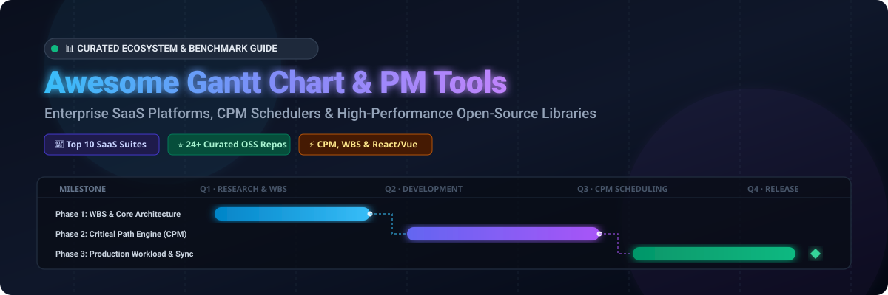

# 📊 Awesome Project Management & Gantt Chart Tools 🚀

**A comprehensive, curated directory of leading SaaS platforms and open-source GitHub projects for project management, Gantt charts, interactive timeline visualization, Critical Path Method (CPM) scheduling, and Work Breakdown Structures (WBS).**

*Compare enterprise SaaS solutions with starting pricing, free tiers, and valuations alongside 24+ open-source GitHub repositories ranked by community stars.*

---

## 📑 Table of Contents

- [📈 Sector Overview & Market Dynamics](#-sector-overview--market-dynamics)
- [💼 SaaS & Cloud Hosted Platforms](#-saas--cloud-hosted-platforms)
- [⭐ Open-Source GitHub Projects](#-open-source-github-projects)
- [🔍 Key Evaluation Criteria for Gantt Tools](#-key-evaluation-criteria-for-gantt-tools)
- [🤝 How to Contribute](#-how-to-contribute)
- [📄 Disclaimer & License](#-disclaimer--license)

---

## 📈 Sector Overview & Market Dynamics

The global project management and workflow collaboration software market is estimated at **$7.5 billion to $9.8 billion in 2024–2026** and is projected to surpass **$15 billion by 2030**, expanding at a robust compound annual growth rate (CAGR) of **10.5% to 12.8%**. 

The sector is **moderately fragmented**: mega-cap enterprise incumbents (such as Atlassian Jira and Smartsheet) anchor massive enterprise workflows, while agile Work OS leaders (Monday.com, Asana, ClickUp) capture rapid team adoption, leaving ample high-growth space for specialized timeline engines (GanttPRO, Wrike) and customizable, self-hosted open-source developer libraries.

---

## 💼 SaaS & Cloud Hosted Platforms

The table below compiles premier cloud project management suites with native Gantt timeline capabilities, sorted in descending order by company scale (market capitalization or latest venture valuation).

| 🏢 Platform | 💰 Starting Paid Price | 🎁 Free Tier Limits / Free Trial | 📈 Scale (Valuation / Market Cap) | 🎯 Core Gantt & Project Management Capabilities |
| :--- | :--- | :--- | :--- | :--- |
| [**Jira (Timeline & Roadmaps)**](https://www.atlassian.com/software/jira) | **$7.16 / user / month** (Standard plan) | **Free forever plan** for up to 10 users with 2 GB cloud storage, standard timelines, and basic Scrum/Kanban boards. | **~$45 Billion** (Public: NASDAQ: TEAM) | Atlassian's flagship agile platform featuring interactive Gantt-style Timeline and Advanced Roadmaps across multi-team releases. |
| [**Monday.com**](https://monday.com) | **$9.00 / user / month** (Basic plan, billed annually; min. 3 seats) | **Free forever plan** for up to 2 users, up to 3 boards, 200+ templates, and 500 MB storage (Gantt view requires Standard tier or 14-day Pro trial). | **~$13.5 Billion** (Public: NASDAQ: MNDY) | Highly visual Work OS offering drag-and-drop Gantt widgets, baseline comparisons, milestone tracking, and cross-board timeline views. |
| [**Smartsheet**](https://www.smartsheet.com) | **$9.00 / user / month** (Pro plan, billed annually; max 10 users) | **30-day fully functional free trial** (unlimited sheets and Gantt dependencies, no credit card required; enterprise read-only free tier). | **~$8.4 Billion** (Acquired / Take-private by Blackstone & Vista Equity) | Spreadsheet-native enterprise work execution platform with automated Gantt timelines, Critical Path Method (CPM), and baseline tracking. |
| [**ClickUp**](https://clickup.com) | **$7.00 / user / month** (Unlimited plan, billed annually) | **Free forever plan** with 100 MB storage, unlimited tasks, and unlimited members (includes 60 uses of Gantt chart views; 14-day Business trial). | **~$4.0 Billion** (Series C valuation) | All-in-one productivity suite featuring interactive Gantt views, automatic task reschedule cascades, critical path visualization, and slack time. |
| [**Asana**](https://asana.com) | **$10.99 / user / month** (Starter plan, billed annually) | **Free forever Personal plan** for up to 10 teammates with unlimited tasks, projects, and messages (Timeline/Gantt requires Starter or 30-day free trial). | **~$3.0 Billion** (Public: NYSE: ASAN) | Collaborative work management tool providing Timeline view with real-time dependency conflict resolution and portfolio roadmap tracking. |
| [**Wrike**](https://www.wrike.com) | **$9.80 / user / month** (Team plan, billed annually; 2–25 users) | **Free forever plan** for unlimited users with web/mobile apps and basic task lists (interactive Gantt charts included in 14-day free trial). | **~$2.25 Billion** (Acquired / Private Equity, formerly STG / Citrix) | Robust enterprise work platform featuring dynamic Gantt charts, snapshot baselines, critical path analysis, and resource workload leveling. |
| [**Zoho Projects**](https://www.zoho.com/projects/) | **$4.00 / user / month** (Premium plan, billed annually) | **Free forever plan** for up to 3 users and 2 projects with 5 GB storage; offers a 10-day fully featured free trial of paid tiers. | **~$1.0+ Billion** (Part of privately held Zoho Corp with $1B+ ARR) | Cost-effective project management offering milestone tracking, 4 types of task dependencies (FS, SS, FF, SF), and resource utilization charts. |
| [**Teamwork.com**](https://www.teamwork.com) | **$5.99 / user / month** (Deliver plan, billed annually; min. 3 users) | **Free forever plan** for up to 5 users with basic subtasks and milestone lists; provides a 30-day fully featured free trial of Deliver/Grow plans. | **~$400 Million** (Growth equity backed by Bregal Milestone) | Client-focused operations platform pairing interactive Gantt charts with billable time tracking, client portals, and project budget forecasting. |
| [**Hive**](https://hive.com) | **$5.00 / user / month** (Hive Starter, billed annually) | **Free forever Hive Free plan** for up to 10 users with unlimited tasks and collaborative notes; offers a 14-day full-access trial for Hive Teams. | **~$100 Million** (Venture funded: Series B) | Fast-paced project platform allowing instant switching between Gantt timelines, Kanban boards, calendar views, and summary portfolios. |
| [**GanttPRO**](https://ganttpro.com) | **$7.99 / user / month** (Basic plan, billed annually) | **14-day fully featured free trial** with unlimited team members, dependencies, and auto-scheduling (no credit card required; PDF/PNG exports carry watermarks). | **~$20 Million - $30 Million** (Self-funded, bootstrap profitable with $5M+ ARR) | Dedicated Gantt software purpose-built for schedule planning, auto-scheduling, critical path calculation, and resource workload allocation. |

---

## ⭐ Open-Source GitHub Projects

Curated list of self-hosted project management suites, desktop Gantt software, and interactive JavaScript/TypeScript charting libraries. Ranked in descending order by GitHub stargazers.

| 📦 Repository & Link | ⭐ Community Stars | 🛠️ Technology Stack | 📝 Description & Highlights |
| :--- | :--- | :--- | :--- |
| [**mermaid-js/mermaid**](https://github.com/mermaid-js/mermaid) |  | JavaScript / Markdown | Plain-text Markdown diagramming and charting tool with first-class syntax support for version-controllable Gantt diagrams. |
| [**makeplane/plane**](https://github.com/makeplane/plane) |  | TypeScript / Python / Django | Modern open-source project management suite and Linear/Jira alternative featuring cycle planning, timeline views, and issue triage. |
| [**wekan/wekan**](https://github.com/wekan/wekan) |  | JavaScript / Meteor / Node.js | Distributed open-source collaborative kanban board with roadmap tracking, subtasks, and calendar/timeline timeline extensions. |
| [**opf/openproject**](https://github.com/opf/openproject) |  | Ruby on Rails / Angular | Enterprise-grade self-hosted project management suite with full interactive Gantt charts, WBS hierarchies, and CPM scheduling. |
| [**plantuml/plantuml**](https://github.com/plantuml/plantuml) |  | Java | Leading text-to-UML engine generating crisp PNG/SVG Gantt charts, work breakdown structures, and project timelines directly from code. |
| [**plankanban/planka**](https://github.com/plankanban/planka) |  | React / Node.js / PostgreSQL | Sleek, self-hosted Kanban board and project tracker built with React and Redux, ideal for team task flows and timeline planning. |
| [**Leantime/leantime**](https://github.com/Leantime/leantime) |  | PHP / JavaScript / MySQL | Strategic open-source project management platform tailored for cross-functional teams, combining Gantt timelines with Lean canvases. |
| [**usekaneo/kaneo**](https://github.com/usekaneo/kaneo) |  | TypeScript / Next.js / Tailwind | Fast, minimalist project management solution featuring intuitive visual boards, Gantt charts, and two-way GitHub issue integration. |
| [**AhmadHassan-BTed/Jantt**](https://github.com/AhmadHassan-BTed/Jantt) |  | JavaScript / Web Components | Interactive zero-code Gantt chart builder featuring built-in BYOK AI Copilot, CPM calculation, 6 view modes, and multi-framework support. |
| [**frappe/gantt**](https://github.com/frappe/gantt) |  | Vanilla JavaScript / SVG | Beautiful, ultra-lightweight SVG JavaScript Gantt chart library with drag-and-drop task resizing, dependency links, and time modes. |
| [**redmine/redmine**](https://github.com/redmine/redmine) |  | Ruby on Rails | Battle-tested open-source issue tracker and project management platform featuring built-in Gantt charts and calendar scheduling. |
| [**mark-when/markwhen**](https://github.com/mark-when/markwhen) |  | TypeScript / Vue | Text-to-timeline tool converting markdown-like syntax into beautiful cascading interactive Gantt charts and timeline visualizations. |
| [**neuronetio/gantt-schedule-timeline-calendar**](https://github.com/neuronetio/gantt-schedule-timeline-calendar) |  | TypeScript / Svelte Core | High-performance multi-purpose scheduling library supporting Gantt charts, timeline schedules, and calendar grids with React/Vue/Angular wrappers. |
| [**croffasia/itsaplan**](https://github.com/croffasia/itsaplan) |  | TypeScript / React / Node.js | Open-source alternative to Linear and Plane where engineering teams and autonomous AI agents collaborate along project timelines. |
| [**robicch/jQueryGantt**](https://github.com/robicch/jQueryGantt) |  | JavaScript / jQuery / CSS | Lightweight, battle-tested jQuery Gantt component featuring tree-grid task lists, dependency drawing, and export capabilities. |
| [**DHTMLX/gantt**](https://github.com/DHTMLX/gantt) |  | JavaScript | Industry-standard JavaScript Gantt chart library (GPLv2 edition) supporting deep WBS task hierarchies and high-volume performance. |
| [**neuronetio/gantt-elastic**](https://github.com/neuronetio/gantt-elastic) |  | Vue.js / JavaScript | Highly configurable and elastic Vue.js Gantt chart component designed for responsive timeline navigation and task scheduling. |
| [**bardsoftware/ganttproject**](https://github.com/bardsoftware/ganttproject) |  | Java / Desktop | Dedicated open-source desktop scheduling app for Windows/macOS/Linux featuring Gantt charts, PERT charts, and MS Project compatibility. |
| [**MaTeMaTuK/gantt-task-react**](https://github.com/MaTeMaTuK/gantt-task-react) |  | React / TypeScript | Feature-rich React Gantt chart component with TypeScript typings, interactive drag-and-drop bars, and multiple view scales. |
| [**taskjuggler/TaskJuggler**](https://github.com/taskjuggler/TaskJuggler) |  | Ruby | Powerful declarative project management tool computing optimal CPM schedules, automatic resource leveling, and detailed HTML/SVG reports. |
| [**zunnzunn/vue-ganttastic**](https://github.com/zunnzunn/vue-ganttastic) |  | Vue 3 / TypeScript | Simple, modern, and highly customizable Gantt chart component built specifically for Vue 3 applications. |
| [**jsGanttImproved/jsgantt-improved**](https://github.com/jsGanttImproved/jsgantt-improved) |  | Pure JavaScript / CSS | Fully featured standalone JavaScript Gantt chart library requiring zero external dependencies, images, or third-party libraries. |
| [**joniles/mpxj**](https://github.com/joniles/mpxj) |  | Java / C# (.NET) | Universal project data exchange library for reading and writing Microsoft Project (MPP/XML), Primavera P6, and GanttProject files. |
| [**svar-widgets/react-gantt**](https://github.com/svar-widgets/react-gantt) |  | React / TypeScript | Modern, high-performance React Gantt chart component supporting tree grids, flexible timeline zoom scales, and custom task bars. |

---

## 🔍 Key Evaluation Criteria for Gantt Tools

When evaluating project management software and Gantt timeline engines for team workflows, consider:

1. **Scheduling Engine & Critical Path Method (CPM)**: Does the tool automatically calculate critical paths and adjust downstream dependent dates when upstream tasks slip?
2. **Dependency Modeling**: Support for all standard dependency relationships — Finish-to-Start (FS), Start-to-Start (SS), Finish-to-Finish (FF), and Start-to-Finish (SF), with positive/negative lead and lag times.
3. **Resource Capacity & Workload Balancing**: Real-time visibility into over-allocated or under-allocated team members across concurrent initiatives.
4. **Baseline Variance Tracking**: Ability to freeze target schedule baselines and visually contrast planned vs. actual project velocity.
5. **Self-Hosting vs. Managed Cloud**: Open-source options (OpenProject, Plane, Leantime) grant full data governance, while SaaS suites provide turnkey mobile apps, integrations, and automated backups.

---

## 🤝 How to Contribute

We welcome community contributions! To suggest a new project management platform or open-source Gantt library:

1. 🍴 **Fork** this repository.
2. 🌿 Create a new feature branch (`git checkout -b feature/add-new-gantt-tool`).
3. 📝 Update `README.md` following the existing tabular structure, including exact starting prices, verified free tier limits, star badges, and official links.
4. 🚀 Commit your changes (`git commit -m 'feat: add tool-name to curated list'`).
5. 📤 Push to your fork and submit a **Pull Request**.

---

## 📄 Disclaimer & License

- *Disclaimer*: All product names, logos, trademarks, and registered trademarks are property of their respective owners. Mention of SaaS platforms and GitHub repositories does not constitute an official endorsement.
- *Data Accuracy*: Pricing, free tier limits, valuations, and star counts reflect verified public figures as of late 2026 and are updated periodically by the community.
- *License*: Released under the [MIT License](LICENSE).

---

<b>Built with ❤️ for project managers, PMO directors, software engineers, and frontend developers.</b> 
<i>Star ⭐ this repository if you found it useful for your project planning workflow!</i>

